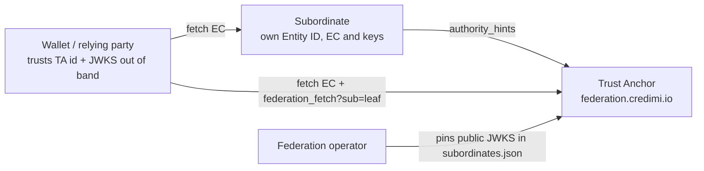

# Integrating issuers and verifiers with the Credimi test federation

This guide explains how an entity — first the issuers and verifier in
[credimi-capture-wallet](https://github.com/ForkbombEu/credimi-capture-wallet),
later anything else — joins the federation run by this Trust Anchor. It
describes work done **in the subordinate's own repository and by the
federation operator**; nothing here changes this service's code.

The federation is a Credimi-operated test federation. Joining it does not make
an entity part of the EUDI Wallet ecosystem, IT-Wallet, or any other official
trust framework.

## Roles



The Trust Anchor signs a statement saying "this Entity Identifier uses these
public federation keys". It never holds the subordinate's private keys and
never speaks for it: the subordinate signs its own Entity Configuration.

## Intended first subordinates

| Entity Identifier                                                      | Entity type                  |
| ---------------------------------------------------------------------- | ---------------------------- |
| `https://capture-wallet.credimi.io/issuers/eu-pid-device-bound`        | `openid_credential_issuer`   |
| `https://capture-wallet.credimi.io/issuers/eu-pid-jwt-key-attestation` | `openid_credential_issuer`   |
| Verifier — to be decided when the verifier is integrated               | `openid_credential_verifier` |

These are integration targets, not registrations. None is in the registry
until its operator supplies real public federation keys.

## What each issuer or verifier needs

### 1. Its own federation signing keys

Generate a dedicated key pair for federation statements (ES256 recommended),
with a `kid` (the RFC 7638 thumbprint is recommended). It must be separate from:

- TLS certificates,
- credential-signing keys (SD-JWT VC / mDoc issuer keys),
- OpenID4VP request-signing keys and any other protocol keys, which belong in
  the protocol metadata (`jwks` inside `openid_credential_issuer` or
  `openid_credential_verifier`), not in the top-level `jwks` claim.

Keep the private key out of Git and backed up like any identity key.

### 2. Its own signed Entity Configuration

Serve a JWT at `<entity_id>/.well-known/openid-federation` with media type
`application/entity-statement+jwt`. For an Entity Identifier with a path, the
well-known suffix is appended to the full identifier, e.g.
`https://capture-wallet.credimi.io/issuers/eu-pid-device-bound/.well-known/openid-federation`.

JOSE header: `{"alg": "ES256", "typ": "entity-statement+jwt", "kid": "<federation key kid>"}`.

Claims (abridged):

```json
{
  "iss": "https://capture-wallet.credimi.io/issuers/eu-pid-device-bound",
  "sub": "https://capture-wallet.credimi.io/issuers/eu-pid-device-bound",
  "iat": 1795176000,
  "exp": 1795262400,
  "jwks": {
    "keys": [
      { "kty": "EC", "crv": "P-256", "x": "…", "y": "…", "kid": "…", "alg": "ES256", "use": "sig" }
    ]
  },
  "authority_hints": ["https://federation.credimi.io"],
  "metadata": {
    "openid_credential_issuer": {
      "credential_issuer": "https://capture-wallet.credimi.io/issuers/eu-pid-device-bound",
      "credential_endpoint": "…",
      "credential_configurations_supported": { "…": {} }
    }
  }
}
```

Sign it with the federation key, re-issue it before `exp`, and keep `iss`,
`sub` and the served URL byte-for-byte equal to the Entity Identifier.

### 3. `authority_hints` pointing to the Trust Anchor

`authority_hints` must be `["https://federation.credimi.io"]` (or whatever
`FEDERATION_ENTITY_ID` the Trust Anchor is deployed with). A leaf must not
publish `federation_fetch_endpoint` or `federation_list_endpoint`.

### 4. Registration of its public federation keys

Send the federation operator, over a channel the operator already trusts
(signed commit, direct exchange — not just a URL to fetch):

- the Entity Identifier,
- the **public** federation JWK Set (no `d` or other private members),
- the entity types it will publish.

The operator adds an entry to the registry file (see the README's
"Registering a subordinate"), runs `task check`, and restarts the service.
Before enabling the entry, the operator compares the `kid` values with those in
the subordinate's live Entity Configuration. A reachable, self-signed Entity
Configuration is never enough on its own: Trust Chain validation fails if the
Entity Configuration is signed with a key the Trust Anchor did not pin.

When the subordinate rotates its federation key, it sends the new public key
first; the operator publishes both keys, and the subordinate switches signing
only after the Trust Anchor serves the new Subordinate Statement.

### 5. Protocol-specific federation metadata

The Entity Configuration's `metadata` carries the protocol metadata for each
entity type the entity plays:

- Issuers: `openid_credential_issuer` (OpenID4VCI issuer metadata).
- Verifiers: `openid_credential_verifier` (OpenID4VP verifier metadata).
- Wallet providers: `openid_wallet_provider`.

These entity types and their parameters come from
[OpenID Federation for Wallet Architectures 1.0](https://openid.net/specs/openid-federation-wallet-1_0.html),
which is **draft 06** at the time of writing. Track the draft in the
subordinate's repository; the Trust Anchor does not interpret this metadata.
If the operator configures a `metadata_policy` for a subordinate, the
subordinate's published metadata must satisfy it.

### 6. Participants configured to trust the Trust Anchor

A wallet or relying party needs two values from the operator, distributed out
of band:

- the Trust Anchor Entity Identifier, e.g. `https://federation.credimi.io`;
- its public JWK Set (`node dist/cli.js jwks` on the Trust Anchor host).

It must validate chains against that pinned JWK Set, not against whatever the
Trust Anchor's Entity Configuration currently contains.

Notes for the Credo.TS-based capture wallet, from a local Credo checkout
(commit `05e7332e`, 07/10/2026) and not yet verified against the version the
capture wallet pins: Credo's holder resolves verifiers that use the
`openid_federation` client identifier prefix with `@openid-federation/core`,
and its verifier service rejects the `federation` JWT signer method. Confirm
both before planning the verifier integration.

## Verifying that the Trust Anchor and a subordinate work together

1. The subordinate's Entity Configuration is reachable and correctly typed:

   ```sh
   LEAF=https://capture-wallet.credimi.io/issuers/eu-pid-device-bound
   curl -sD - "$LEAF/.well-known/openid-federation" -o leaf.jwt | grep -i content-type
   # content-type: application/entity-statement+jwt
   cut -d. -f1 leaf.jwt | base64 -d 2>/dev/null; echo   # typ entity-statement+jwt, kid
   cut -d. -f2 leaf.jwt | base64 -d 2>/dev/null; echo   # authority_hints, jwks, metadata
   ```

2. The Trust Anchor publishes a statement about it:

   ```sh
   TA=https://federation.credimi.io
   curl -s "$TA/federation_list"
   curl -s "$TA/federation_fetch?sub=$(node -p 'encodeURIComponent(process.argv[1])' "$LEAF")" -o statement.jwt
   cut -d. -f2 statement.jwt | base64 -d 2>/dev/null; echo  # iss = TA, sub = LEAF, jwks
   ```

   The `kid` in `leaf.jwt`'s header must appear in `statement.jwt`'s `jwks`.

3. The whole chain validates against the pinned Trust Anchor key. With Node.js
   and `@oidfed/core`:

   ```js
   import { createTrustAnchorSet, resolveTrustChains, validateTrustChain } from "@oidfed/core";
   import { readFile } from "node:fs/promises";

   const anchors = createTrustAnchorSet([
     {
       entityId: "https://federation.credimi.io",
       jwks: JSON.parse(await readFile("ta.jwks.json", "utf8")),
     },
   ]);
   const { chains, errors } = await resolveTrustChains(process.argv[2], anchors);
   if (chains.length === 0) throw new Error(JSON.stringify(errors));
   const result = await validateTrustChain(chains[0].statements, anchors);
   console.log(result.valid, result.errors);
   ```

   `ta.jwks.json` is the JWK Set obtained out of band in step 6.

This repository's `tests/trust-chain.e2e.test.ts` performs the same checks
offline with a generated subordinate, using `@openid-federation/core`, a
direct `jose` implementation of OpenID Federation 1.0 §10.2, and
`@oidfed/core`. It also shows that an Entity Configuration signed with an
unpinned key is rejected.
